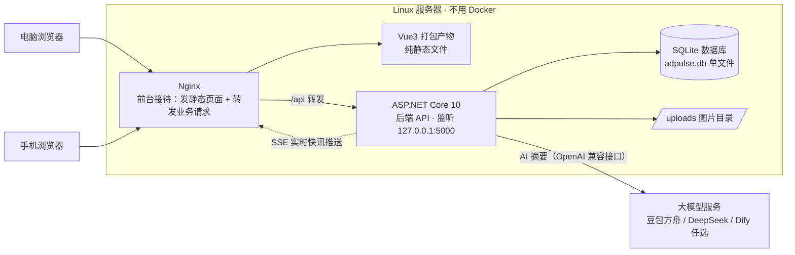

# AdPulse · 广告脉搏 —— 分步验收实施计划

> 版本：v1.0 ｜ 编制日期：2026-11-20
> 定位：广告行业新闻门户 + 后台内容管理系统（求职面试作品）
> 已确认的关键决策：**数据库用 SQLite（开源、单文件、零安装）；全程不用 Docker；部署到 Linux 服务器（裸机）；AI 新闻摘要列为正式验收步骤；电脑端 + 手机端全适配。**

---

## 0. 这份文档怎么用（先读我）

把整个项目想象成**盖一栋楼**：本文档是施工总图纸，7 个步骤是 7 个施工阶段，每个阶段末尾有一张**验收清单**——就像验房，逐项打勾，全勾上才进入下一阶段。

具体操作方式：

1. **每一步 = 一轮 AI 任务**。把该步的「给 AI 的指令块」整段复制给你的 AI 编程工具（Trae / Cursor / 豆包等）。
2. **先让 AI 读图纸再动工**：第 1 步会把本文档放进仓库 `docs/` 目录，之后每步指令都要求 AI 先读它，保证 7 个阶段用的是同一套规范，不会各干各的（这就是"整体性"的来源）。
3. **验收全过才走下一步**。清单里每一项都写了"怎么操作、应该看到什么"，不需要你看懂代码。
4. **卡住怎么办**：把报错原文完整贴回给 AI，说"修复它，并告诉我改了哪些文件"。不要自己瞎改。
5. **每步完成后打 Git 标签**（`step-1` ~ `step-7`），相当于游戏存档——后面做崩了可以回档，不用从头再来。

---

## 1. 项目总览

### 1.1 一句话定位

「AdPulse · 广告脉搏」：一个深色"行业情报终端"风格的广告行业新闻网站。访客看新闻、查行业数据；管理员登录后发文、管内容；发布瞬间全站实时推送快讯；AI 自动给新闻生成摘要和标签。

### 1.2 功能地图

| 板块 | 功能 |
|---|---|
| 前台门户 | 首页（头条轮播 / 分类 Tab / 热榜 TOP10 / 数据可视化区）、新闻列表（筛选 / 搜索高亮 / 分页 / 排序）、新闻详情（富文本 / 浏览量 / 相关推荐 / AI 摘要卡片）、行业数据页（4 种图表） |
| 后台管理 | JWT 登录、双角色权限（管理员 / 编辑）、新闻管理（富文本编辑 / 封面上传 / 草稿-发布-置顶-回收站）、分类 / 标签 / 轮播图管理、数据看板、操作日志 |
| 亮点能力 | SSE 实时快讯（发布秒级推到所有在线页面）、AI 摘要 + 自动标签（无密钥时自动降级为规则摘要）、明暗双主题、电脑 / 手机全响应式 |

### 1.3 整体架构（一张图看懂）



- **本地开发时**：前端 `npm run dev`（5173 端口）+ 后端 `dotnet run`（5000 端口），前端开发服务器把 `/api` 请求代理给后端，两个进程各跑各的。
- **服务器上**：Nginx 一个入口全接管——浏览器要页面就给静态文件，要数据就转给后端；数据库就是服务器上的一个文件，备份 = 复制文件。**没有 Docker，没有独立数据库服务进程。**

### 1.4 步骤总览与依赖关系

| 步骤 | 名称 | 预估工作量（AI 辅助） | 依赖 |
|---|---|---|---|
| 1 | ~~基础骨架与数据库~~ ✅ | 0.5 ~ 1 天 | 无 |
| 2 | ~~后端 API 全量完成~~ ✅ | 1 ~ 1.5 天 | 步骤 1 |
| 3 | ~~前台门户（4 个页面）~~ ✅ | 1 ~ 1.5 天 | 步骤 2 |
| 4 | ~~后台管理（全套）~~ ✅ | 1 ~ 1.5 天 | 步骤 2（可与 3 并行，但建议顺序做） |
| 5 | SSE 实时快讯 + 体验打磨 | 0.5 ~ 1 天 | 步骤 3、4 |
| 6 | ~~AI 摘要与自动标签~~ ✅ | 0.5 ~ 1 天 | 步骤 4 |
| 7 | Linux 裸机部署 + 整体终验 | 0.5 ~ 1 天 | 全部 |

> 工作量是参考值，按每天投入 2~4 小时估算；卡壳修 bug 的时间因人而异，宁可慢一步验收扎实，不要带病进下一步。

---

## 2. 全局约定（所有步骤共同遵守的"宪法"）

> 本章是整体性的核心。每一步的 AI 指令都会要求先读本章。任何一步想改这里的约定，必须先改本文档，再改代码。

### 2.1 仓库目录结构（单仓库）

```text
adpulse/
├── docs/
│   └── AdPulse项目实施计划.md      ← 本文档，AI 每步开工前必读
├── backend/
│   └── AdPulse.Api/
│       ├── Controllers/            ← 只管接收 HTTP 请求、返回结果
│       ├── Services/               ← 业务逻辑都在这
│       ├── Repositories/           ← 只管读写数据库
│       ├── Models/                 ← 数据库实体
│       ├── Dtos/                   ← 对外传输的数据形状（不直接暴露实体）
│       ├── Middlewares/            ← 全局异常处理等
│       ├── Data/                   ← DbContext、Migrations、种子数据
│       ├── App_Data/               ← adpulse.db 存放处（不进 Git）
│       └── wwwroot/uploads/        ← 上传图片（不进 Git）
├── frontend/
│   ├── src/
│   │   ├── api/                    ← axios 封装 + 按模块拆分的接口定义
│   │   ├── stores/                 ← Pinia（用户态、主题态）
│   │   ├── router/                 ← 路由 + 守卫
│   │   ├── views/portal/           ← 前台 4 页
│   │   ├── views/admin/            ← 后台页面
│   │   ├── components/             ← 公共组件
│   │   └── styles/                 ← 主题变量（明/暗）
│   └── .env.development / .env.production
└── README.md                       ← 第 7 步完成：架构图 + 启动步骤 + 选型理由
```

### 2.2 技术栈与版本基线（2026-11 核实，全部不过时）

| 层 | 技术 | 版本基线 | 选型理由（面试可直接讲） |
|---|---|---|---|
| 后端框架 | .NET / ASP.NET Core | **10.0（LTS）** | 2025-11 发布的长期支持版，官方支持到 2028-11-14。不选刚出的 .NET 11：它是 STS 短期支持（2 年），LTS 才是生产惯例 |
| ORM | EF Core + SQLite Provider | 10.x | 与 .NET 10 同代；Code First + Migrations |
| 数据库 | **SQLite** | 3.x（随 Provider 内置） | 开源免费、零安装、整库单文件；开启 WAL 模式后"多读少写"的新闻站完全够用；服务器备份就是复制一个文件 |
| 认证 | JWT Bearer | 10.x | 无状态令牌，前后端分离标配 |
| 日志 | Serilog | 最新稳定版 | 控制台 + 滚动文件双输出 |
| 参数校验 | FluentValidation | 最新稳定版 | 校验规则独立成类，不堆在 Controller |
| 前端框架 | Vue | **3.5.x 最新稳定版** | 3.6（Vapor）截至 2026-10 仍是 RC 预发布，面试作品不上预发布版 |
| 构建工具 | Vite | **8.x** | 2026-03 稳定版，底层换成 Rust 打包器 Rolldown，构建快 10~30 倍，是很新的面试谈资 |
| 语言 | TypeScript | 5.x 最新 | 全前端强类型 |
| 状态管理 | Pinia | 3.x | Vue3 官方推荐 |
| 路由 | Vue Router | 4.x 最新 | history 模式 |
| UI 组件库 | Element Plus | 2.x 最新 | Vue3 生态最成熟，后台管理效率最高 |
| 图表 | ECharts | 6.x | 数据页 + 看板共用 |
| 富文本编辑器 | TipTap | 3.x | Vue3 原生支持、国际主流，比老一代 wangEditor 更现代 |
| HTTP 客户端 | axios | 1.x | 统一拦截器 |
| 构建机运行时 | Node.js | 22 或 24 LTS | 只在开发/打包时需要，服务器不需要 Node |

**版本来源**（写 README 时可引用）：
- .NET 支持政策（10 LTS / 11 STS）：https://dotnet.microsoft.com/zh-cn/platform/support/policy
- Vite 8 发布公告（Rolldown）：https://vite.dev/blog/announcing-vite8
- Vue 3.6 仍处 RC 的佐证：https://0.vuetifyjs.com/guide/integration/vapor

### 2.3 统一 API 返回体与错误码

所有接口（包括报错）都返回同一个 JSON 形状，前端只认这一种：

```json
{ "code": 0, "message": "ok", "data": { } }
```

| code | HTTP 状态码 | 含义 |
|---|---|---|
| 0 | 200 | 成功 |
| 40000 | 400 | 参数错误（message 必须是中文、说清哪个字段错） |
| 40100 | 401 | 未登录或 token 过期 |
| 40300 | 403 | 已登录但权限不够 |
| 40400 | 404 | 资源不存在 |
| 50000 | 500 | 服务器异常（对外只给通用提示，细节进日志） |

### 2.4 路由约定

- 前台数据：`/api/portal/**`（匿名可访问）
- 登录相关：`/api/auth/**`
- 后台管理：`/api/admin/**`（必须带 token；部分接口仅 Admin 角色）
- 实时推送：`/api/sse/**`
- 前端页面路由：前台 `/`、`/news`、`/news/:id`、`/data`；后台 `/admin/login`、`/admin/**`（路由守卫拦截）

### 2.5 数据库表结构总览（第 1 步一次建齐，后面只加不改）

| 表 | 关键字段 | 用途 |
|---|---|---|
| Users | Id, UserName, PasswordHash, DisplayName, Role(Admin/Editor), CreatedAt | 账号，密码只存哈希 |
| Categories | Id, Name, Slug, SortOrder | 五大分类：品牌营销 / 数字广告 / 创意案例 / 媒介投放 / 行业动态 |
| Tags | Id, Name | 标签 |
| News | Id, Title, Summary, Content, CoverUrl, CategoryId, AuthorId, Status(Draft/Published/Recycled), IsTop, IsHeadline, ViewCount, PublishedAt, CreatedAt, UpdatedAt, AiSummary, AiTagsJson, AiStatus(None/Pending/Done/Fallback/Failed) | 新闻主表（AI 三字段第 1 步就预留，第 6 步直接用，避免中途改表） |
| NewsTags | NewsId, TagId | 新闻↔标签多对多 |
| Banners | Id, ImageUrl, LinkNewsId, SortOrder, IsEnabled | 首页轮播 |
| ViewLogs | Id, NewsId, ViewedAt | 浏览记录，看板趋势图的数据源 |
| OperationLogs | Id, UserId, Action, Target, Detail, CreatedAt | 后台操作日志 |

SQLite 专项约定：连接串使用**绝对路径**；启动时执行 `PRAGMA journal_mode=WAL;`；`App_Data/` 与 `uploads/` 写入 `.gitignore`。

### 2.6 角色权限矩阵

| 操作 | Admin | Editor |
|---|---|---|
| 新闻增改、发布、置顶、进回收站 | ✅ | ✅（仅限自己的文章） |
| 删除/回收他人文章、还原回收站 | ✅ | ❌ |
| 分类 / 标签 / 轮播图管理 | ✅ | ❌（只读） |
| 数据看板 / 操作日志 | ✅ | 看板✅ / 日志❌ |

### 2.7 视觉与响应式规范

- 主色 `#0B0E14` 深空黑 + 点缀色 `#FF5A1F` 电光橙；**禁止满屏紫色渐变模板脸**；明暗双主题（CSS 变量切换）。
- 断点：≥1200px 电脑；768~1199px 平板；<768px 手机。手机端导航折叠为抽屉、轮播可手势滑动、表格改卡片式列表。
- 动效四件套：卡片 hover 浮起、统计数字滚动、路由切换过渡、骨架屏加载。

### 2.8 安全底线（每步都适用）

1. 密码用 ASP.NET Core `PasswordHasher` 哈希，数据库永不见明文。
2. AI 密钥、JWT 签名密钥：开发机放 `appsettings.Development.json`（不进 Git），服务器放环境变量（第 7 步）。
3. 上传仅限 jpg/png/webp，≤5MB，服务端重命名为 GUID 存储。
4. 生产环境关闭 Swagger 匿名访问（第 7 步处理）。
5. 种子演示账号 `admin / AdPulse@2026`、`editor / Editor@2026` 仅用于演示，**部署到公网后第一件事改密码**。

### 2.9 Git 里程碑

每步验收通过后执行：`git add -A && git commit -m "step-N: 步骤名" && git tag step-N`。

---

## ~~3. 步骤 1：基础骨架与数据库~~

### ~~这一步做什么（说人话）~~

~~先搭骨架、建仓库：前后端两个空项目能跑起来，数据库把 8 张表**一次建齐**，塞进 30 条像真新闻的演示数据。后面所有步骤都往这个骨架上挂肉，不再动地基。~~

### ~~给 AI 的指令块（整段复制）~~（已执行）

```text
先完整阅读 docs/AdPulse项目实施计划.md（若仓库还没有此文件，我会先放进去），严格执行其中"第 2 章全局约定"，本步只做第 3 章步骤 1 的范围，不许提前做后面步骤的功能。

任务：
1. 按 2.1 目录结构创建单仓库：backend/AdPulse.Api（net10.0，三层架构目录建齐）+ frontend（Vite 8 + Vue 3.5 稳定版 + TypeScript + Pinia 3 + Vue Router 4 + Element Plus）。
2. EF Core 10 + SQLite：按 2.5 建全部 8 张表（含 News 的 AI 预留字段），生成 Migrations，启动时自动迁移，开启 WAL，连接串用绝对路径指向 App_Data/adpulse.db。
3. 种子数据：2 个账号（admin/AdPulse@2026、editor/Editor@2026，PasswordHasher 哈希）、5 个分类、12 个标签、30 条真实感广告行业新闻（标题写成真新闻的样子，如"某新能源品牌官宣全球代言人，首支 TVC 全网上线"；正文 3~5 段富文本；分类标签齐全；发布时间错开最近 60 天；浏览量 200~20000 随机；其中 3 条设为头条）、3 张轮播图（指向头条新闻，封面用本地占位图）。
4. 基础设施一次到位：统一返回体（2.3）、全局异常中间件、Serilog（控制台+按天滚动文件 logs/）、FluentValidation 接入、CORS（允许 http://localhost:5173）、Swagger、GET /api/health。
5. 前端空壳：axios 统一封装（拦截器按 2.3 解析 code，401 跳登录的逻辑先留好钩子）、Vite 代理 /api → http://localhost:5000、首页先放一张"骨架已就绪"卡片，调用 /api/health 并把结果显示出来。
6. .gitignore 覆盖 App_Data、uploads、logs、node_modules、bin/obj、appsettings.Development.json。

完成后报告：新增/修改的文件清单、两个项目各自的启动命令、你自测的结果。不要生成 README 正文（第 7 步才写）。
```

### ~~验收清单（全勾才进下一步）~~（✅ 全部通过）

- [x] ~~后端 `dotnet run` 启动无红色报错，控制台能看到 Serilog 日志输出~~
- [x] ~~浏览器打开 `http://localhost:5000/swagger`，能看到接口列表和统一返回体说明~~
- [x] ~~浏览器访问 `/api/health`，返回 `{"code":0,...}`~~
- [x] ~~`backend/AdPulse.Api/App_Data/adpulse.db` 文件存在；用免费工具 DB Browser for SQLite 打开，News 表恰好 30 条、Users 表 2 条且密码是一长串哈希（不是明文）~~
- [x] ~~前端 `npm run dev` 打开 `http://localhost:5173`，页面上显示出后端健康检查的成功结果（证明前后端已打通）~~
- [x] ~~故意访问一个不存在的接口如 `/api/portal/xxx`，返回统一 JSON 错误（code=40400），**不是**大段英文异常堆栈~~
- [x] ~~`logs/` 目录出现当天日志文件~~
- [x] ~~重启后端一次，数据还在、不重复播种（种子只灌一次）~~
- [x] ~~打标签 `step-1`~~

### ~~常见坑~~

- NuGet / npm 拉包慢或超时 → 让 AI 换国内镜像源（npmmirror 等）。
- 5000/5173 端口被占 → 让 AI 换端口并同步改代理配置。
- AI 偷懒用了旧模板（.NET 8 / Vue 3.4 / Vite 5）→ 对照 2.2 版本表打回重做。

~~---~~

## ~~4. 步骤 2：后端 API 全量完成~~

### ~~这一步做什么（说人话）~~

~~把"后厨"的全部菜谱写完：前台看新闻要的接口、后台管内容要的接口、登录发票（JWT）的接口，一次做齐并用 Swagger 逐个试菜。这一步做完，网站的全部能力已经存在，只是还没有好看的"店面"。~~

### ~~接口清单（AI 按此实现，共 26 个）~~

| 模块 | 接口 |
|---|---|
| 认证 | POST `/api/auth/login`（发 JWT，含角色声明，有效期 12h）；GET `/api/auth/me` |
| 前台 | GET `/api/portal/home`（聚合：轮播+头条+各分类最新 5 条+热榜 10）；GET `/api/portal/news`（categoryId/keyword/page/pageSize/sort=time\|hot）；GET `/api/portal/news/{id}`（浏览量+1 并写 ViewLogs）；GET `/api/portal/news/{id}/related`（同分类或同标签 4 条）；GET `/api/portal/hot`；GET `/api/portal/categories`；GET `/api/portal/stats`（数据页 4 图数据） |
| 后台-新闻 | GET/POST/PUT/DELETE `/api/admin/news`（列表含草稿筛选；DELETE=进回收站）；PATCH `/api/admin/news/{id}/status`（发布/撤回/置顶/取消置顶/回收/还原，按 2.6 权限矩阵）；POST `/api/admin/news/{id}/ai-summary`（本步先返回"未启用"占位，第 6 步实现） |
| 后台-其他 | 分类、标签、轮播图各自 GET/POST/PUT/DELETE；POST `/api/admin/upload`（图片）；GET `/api/admin/dashboard`（发文量/浏览量近 30 天趋势、分类占比、TOP10）；GET `/api/admin/logs`（分页） |

### ~~给 AI 的指令块~~（已执行）

```text
先读 docs/AdPulse项目实施计划.md 第 2 章与第 4 章。本步只做后端，不改前端页面。

按第 4 章接口清单实现全部 26 个接口，要求：
1. 严格三层：Controller 薄壳 → Service 业务 → Repository 数据访问；全程 DTO，禁止把 EF 实体直接序列化返回。
2. JWT Bearer 认证 + 基于角色的授权策略，权限按 2.6 矩阵落实到每个接口；密码校验用 PasswordHasher。
3. 每个写入接口配 FluentValidation 规则，校验失败返回 code=40000 + 中文字段级提示。
4. 搜索接口返回命中位置信息或前端可高亮的原文片段；分页返回 total/page/pageSize/items。
5. 后台所有写操作记入 OperationLogs；浏览详情写 ViewLogs。
6. 上传按 2.8 安全底线执行；图片通过静态文件中间件以 /uploads/xxx 访问。
7. 时间一律存 UTC，返回 ISO8601，由前端转本地时间。
8. /api/portal/stats 返回四组数据：近 12 个月广告市场规模趋势（演示数据表或配置）、媒介投放份额、品类投放对比、地区分布——用独立的 DemoIndustryStats 配置/种子提供，并在代码注释注明"行业数据为演示样例"。

完成后报告：文件变更清单、每个接口在 Swagger 里的自测结果（成功/失败示例各一）。
```

### ~~验收清单（全部在 Swagger 里操作，不碰代码）~~（✅ 全部通过）

- [x] ~~`/api/auth/login` 用 admin 账号登录，拿到 token；用错误密码登录，返回中文错误提示~~
- [x] ~~Swagger 右上角 Authorize 填入 token 后，能调通 `/api/admin/news` 列表；**不填 token 调它返回 401**~~
- [x] ~~用 admin 新建一篇新闻（草稿）→ 发布 → 在 `/api/portal/news` 里能查到它；草稿状态时前台查不到~~
- [x] ~~用 editor 登录，尝试删除 admin 的文章 → 返回 403（权限矩阵生效）~~
- [x] ~~新建新闻时标题留空 → 返回 40000，message 指出"标题不能为空"之类的中文提示~~
- [x] ~~访问某篇新闻详情两次，ViewCount 增加 2~~
- [x] ~~上传一张 jpg 成功并可通过返回的 URL 访问；上传 .txt 被拒绝~~
- [x] ~~`/api/portal/stats` 返回四组图表数据~~
- [x] ~~`logs/` 里能搜到刚才的操作记录；OperationLogs 接口能查到"发布新闻"这条日志~~
- [x] ~~打标签 `step-2`~~

### ~~常见坑~~

- 401（没登录）和 403（登录了但没权限）容易混 → 按 2.3 错误码表打回。
- 中文乱码 / 时间差 8 小时 → 提醒 AI 检查 UTF-8 与 UTC 约定。

~~---~~

## ~~5. 步骤 3：前台门户（4 个页面）~~

### ~~这一步做什么（说人话）~~

~~装修"店面"：把步骤 2 做好的数据装进四个好看的页面，电脑上气派、手机上顺手。这一步做完，任何人都能打开网站看新闻了。~~

### ~~给 AI 的指令块~~（已执行）

```text
先读 docs/AdPulse项目实施计划.md 第 2 章与第 5 章。本步只做前台四个页面，不做后台、不做 SSE。

1. 全局：按 2.7 视觉规范搭建布局（毛玻璃悬浮导航 + 页脚），明暗双主题切换（Pinia 持久化），路由过渡动画，全站骨架屏与空状态插画。
2. 首页 /：全屏头条轮播（3 张，自动播放+手势滑动）、五分类 Tab 新闻流、右侧热榜 TOP10（前三名橙色序号）、行业数据预览区（1 张趋势图 + "查看完整数据"入口）、统计数字滚动动画（收录新闻数/总浏览量/分类数，取真实接口数据）。
3. 列表页 /news：分类筛选、关键词搜索（命中词橙色高亮）、时间/热度排序、分页；手机端筛选器收进抽屉。
4. 详情页 /news/:id：面包屑、大标题杂志式排版、富文本渲染（图片自适应）、浏览量与发布时间、标签胶囊、上一篇/下一篇、相关推荐 4 卡片；预留"AI 摘要"卡片位置（本步显示新闻自带 Summary，第 6 步替换为 AI 结果）。
5. 数据页 /data：ECharts 4 图（折线趋势/环形份额/柱状对比/地图或条形地区分布），图表随窗口 resize 自适应，暗色主题同步换肤，页面注明"行业数据为演示样例"。
6. 工程要求：路由懒加载、图片懒加载、axios 按模块拆分、所有列表有空态/加载态/错误态三态处理。

完成后报告：文件变更清单 + 四个页面的路由地址 + 你自测过的交互点。
```

### ~~验收清单~~（✅ 全部通过）

- [x] ~~首页轮播自动播放，点击能进对应新闻详情；五个分类 Tab 切换内容真的变~~
- [x] ~~热榜显示 10 条且按浏览量降序；统计数字有滚动动画且数值与数据库一致~~
- [x] ~~列表页搜索"品牌"之类的词，结果标题/摘要中命中词高亮；分页翻页正常；按热度排序后顺序变化~~
- [x] ~~详情页富文本图片不撑破版面；相关推荐可点击；刷新详情页浏览量 +1~~
- [x] ~~数据页 4 张图全部渲染，拖动浏览器窗口大小图表自适应~~
- [x] ~~明暗主题切换全站生效，刷新后记住选择~~
- [x] ~~**手机端验收**：浏览器开发者工具切到 iPhone 尺寸（375px 宽），四个页面无横向滚动条、导航变抽屉、轮播可滑动、文字可读不重叠~~
- [x] ~~在详情页直接按 F5 刷新不出现 404（history 路由回退正常）~~
- [x] ~~浏览器控制台（F12）无红色报错~~
- [x] ~~打标签 `step-3`~~

### ~~常见坑~~

- ECharts 容器宽度为 0 导致图表空白 → 让 AI 在容器可见后再初始化并监听 resize。
- 手机端表格溢出 → 要求改卡片式布局，不许出现横向滚动。

~~---~~

## ~~6. 步骤 4：后台管理（全套）~~

### ~~这一步做什么（说人话）~~

~~给"店长"配一间控制室：登录进门，写文章、传图片、管栏目、看数据。这一步的核心验收是走通一条真实生产流程——**后台发文，前台立刻能看到**。~~

### ~~给 AI 的指令块~~（已执行）

```text
先读 docs/AdPulse项目实施计划.md 第 2 章与第 6 章。本步只做 /admin 下的后台前端，复用步骤 2 的接口，不改后端业务逻辑（发现接口缺陷可修复并说明）。

1. 登录页 /admin/login：深色品牌视觉，表单校验，登录成功存 token（Pinia+localStorage），axios 拦截器自动携带；401 自动清态跳登录；路由守卫拦住所有 /admin/**。
2. 后台布局：侧边菜单（仪表盘/新闻/分类/标签/轮播图/操作日志）+ 顶栏（当前用户、角色标识、退出登录、跳转前台）；手机端侧边栏折叠。
3. 新闻管理：列表（状态/分类/关键词筛选、分页、置顶标识）、新建/编辑页（TipTap 3 富文本，图片上传走 /api/admin/upload 而非 base64；封面上传预览；分类单选、标签多选；存草稿/直接发布两个按钮）、发布/撤回/置顶/回收操作带确认弹窗；回收站列表与还原（仅 Admin 可见）。
4. 分类/标签/轮播图管理：标准 CRUD 表格 + 弹窗表单；Editor 角色进入时只读（按钮隐藏且接口 403 兜底）。
5. 仪表盘：近 30 天发文量与浏览量双折线、分类占比环形图、浏览 TOP10 表格。
6. 操作日志：分页表格，仅 Admin 可见。
7. 所有删除类操作二次确认；所有表单前后端双重校验；操作成功/失败都有明确提示。

完成后报告：文件变更清单 + 后台入口地址 + 两个演示账号 + 你自测过的完整流程。
```

### ~~验收清单~~（✅ 全部通过）

- [x] ~~未登录直接访问 `/admin` 任意地址 → 被弹回登录页~~
- [x] ~~admin 登录成功；错误密码有中文提示；退出登录后再访问后台被拦截~~
- [x] ~~**核心流程**：新建文章 → TipTap 里插入一张上传的图片 → 存草稿（前台看不到）→ 发布 → 打开前台首页/列表能立刻看到这篇 → 前台详情里图片正常显示~~
- [x] ~~置顶一篇文章 → 前台列表它排最前且有置顶标识；撤回后前台消失~~
- [x] ~~删除文章进回收站，Admin 能还原；回收站外的前台完全看不到它~~
- [x] ~~editor 登录：看不到分类/标签/轮播图的编辑按钮、看不到操作日志和回收站；尝试改 admin 的文章被拒绝~~
- [x] ~~仪表盘三块图表有真实数据（发一篇文章后趋势图当天数值变化）~~
- [x] ~~操作日志里能查到刚才的发布/置顶动作~~
- [x] ~~手机端（375px）后台可正常操作：菜单折叠、列表不破版、编辑页可用~~
- [x] ~~手动把 localStorage 里的 token 改成乱码再操作 → 自动跳回登录页（401 钩子生效）~~
- [x] ~~打标签 `step-4`~~

### ~~常见坑~~

- TipTap 默认把图片转 base64 塞进正文 → 必须走上传接口，否则数据库暴涨。
- 前端隐藏按钮 ≠ 权限控制 → 后端 403 才是底线，两头都要验。

~~---~~

## 7. 步骤 5：SSE 实时快讯 + 体验打磨

### 这一步做什么（说人话）

给网站装一个"店内广播"：店长在后厨喊一嗓子（发布新闻），所有正在逛店的顾客（打开的页面）立刻听到（顶部快讯条滚动），不用顾客每秒跑去问一次"有新消息吗"（那叫轮询，又累又慢）。顺便把整站动效和性能抛光。

### 给 AI 的指令块

```text
先读 docs/AdPulse项目实施计划.md 第 2 章与第 7 章。

1. 后端：用 System.Threading.Channels 做进程内广播；新增 GET /api/sse/newsflash（text/event-stream，匿名可连），连接即发一条 hello 事件，每 15 秒发心跳注释帧；新闻"发布"动作触发广播（事件含 id/标题/时间）；用 IAsyncEnumerable + CancellationToken 正确释放断开连接。
2. 前端：前台顶部快讯条组件，EventSource 订阅；收到事件滚动展示"刚刚发布：xxx"，点击跳详情；断线自动重连（EventSource 原生 + 兜底重试），页面隐藏时暂停动画；后台发布页显示"已推送给 N 个在线页面"可选加分项。
3. 打磨：路由切换过渡、卡片 hover 浮起、按钮微交互、列表交错入场动画（克制，不花哨）；图片懒加载与占位；路由级代码分割确认生效。
4. 性能自查：Lighthouse 移动端跑分并报告四项分数；修复明显失分项（未压缩图片、阻塞渲染等）。

完成后报告：文件变更清单 + SSE 自测过程（双窗口验证实录）+ Lighthouse 分数。
```

### 验收清单

- [ ] **双窗口验证**：A 窗口开前台首页，B 窗口后台发布一篇新闻 → A 窗口 3 秒内出现快讯滚动，点击能跳到刚发的新闻
- [ ] 同时开电脑宽度 + 手机宽度两个前台窗口，发布一次两边都收到
- [ ] 前台页面挂机 10 分钟，控制台无报错、快讯条仍在（心跳保活）
- [ ] 断网 30 秒再恢复（开发者工具 Offline 切换），快讯条自动恢复订阅，再发一篇能收到
- [ ] 关闭所有前台页面后，后端日志显示连接已释放（无泄漏堆积）
- [ ] 撤回/删除新闻不会触发"新发布"快讯
- [ ] Lighthouse 移动端 Performance ≥ 85（参考线，达不到让 AI 给出优化清单再跑）
- [ ] 明暗主题下快讯条样式都正常；手机端不遮挡正文
- [ ] 打标签 `step-5`

### 常见坑

- 本地正常、上线后快讯不动 → 十有八九是 Nginx 缓冲，第 7 步的专属配置解决，先记住这个坑。
- AI 用 WebSocket 偷换 SSE → 打回，本项目面试考点就是 SSE。

---

## ~~8. 步骤 6：AI 摘要与自动标签（正式步骤）~~

### ~~这一步做什么（说人话）~~

~~给每篇新闻配一个"AI 小编"：文章一发布，AI 自动写一句话摘要、贴 3~5 个标签。**没配 AI 密钥也能验收**——系统自动降级成"规则小编"（抽取正文首两句 + 高频词标签），并诚实标注生成方式。网站永远不因 AI 挂了而发不出文章。~~

### ~~给 AI 的指令块~~（已执行）

```text
先读 docs/AdPulse项目实施计划.md 第 2 章与第 8 章。

1. 后端定义 IAiSummaryService 抽象 + OpenAI 兼容协议实现（HttpClient，配置项：BaseUrl / ApiKey / Model / MaxTokens / 超时 30s），可对接豆包方舟、DeepSeek 或 Dify 的 OpenAI 兼容端点；密钥从配置/环境变量读取，严禁硬编码与入库进 Git。
2. 实现步骤 2 预留的 POST /api/admin/news/{id}/ai-summary（手动重新生成，仅作者或 Admin）；新闻发布时自动触发：用 Channel + BackgroundService 后台队列异步生成，绝不阻塞发布接口本身；结果写入 News.AiSummary / AiTagsJson / AiStatus，AI 标签自动合并进 Tags/NewsTags。
3. 降级链路：未配置密钥 → 规则摘要（正文纯文本前两句，≤80 字）+ 分词高频标签，AiStatus=Fallback；调用失败/超时 → 重试 1 次后 AiStatus=Failed，保留旧摘要或规则摘要，记 Serilog 警告。
4. 提示词要求：一句话中文摘要 ≤60 字、客观新闻口吻、3~5 个行业标签，输出严格 JSON（做解析容错）。
5. 前端：详情页"AI 摘要"卡片替换占位（带 AI 图标；Fallback 时标注"规则生成"；Pending 时显示生成中并可轮询刷新）；标签区展示 AI 标签；后台编辑页显示 AI 状态 + "重新生成"按钮。
6. appsettings.Development.json 提供配置示例（假密钥占位），README 素材里记录对接说明（正式 README 第 7 步写）。

完成后报告：文件变更清单 + 有密钥/无密钥两条路径的自测实录。
```

### ~~验收清单~~（✅ 全部通过）

- [x] ~~**无密钥路径**：不配密钥发布一篇新闻 → 详情页出现摘要卡片且标注"规则生成"，标签自动出现；全程无报错~~
- [x] ~~**有密钥路径**（配好任一 OpenAI 兼容服务后）：发布新闻 → 30 秒内摘要变为 AI 生成（AI 标识），标签合理；点"重新生成"能换一版~~
- [x] ~~把密钥故意改错再发布 → 文章照常发布成功，摘要走降级，日志有警告（AI 故障不影响主流程）~~
- [x] ~~生成过程中详情页显示"生成中"，完成后刷新可见结果~~
- [x] ~~检查 Git 提交记录与代码全文，搜不到真实密钥字符串~~
- [x] ~~AI 生成的标签点击后能在列表页筛出相关新闻（标签真实入库，不是摆设）~~
- [x] ~~打标签 `step-6`~~

### ~~常见坑~~

- AI 返回的 JSON 带 markdown 代码块包裹导致解析失败 → 要求做容错清洗。
- 把 AI 调用写进发布事务里，超时导致发文转圈 → 必须异步队列，验收第 3 条就是防这个。

~~---~~

## 9. 步骤 7：Linux 裸机部署 + 整体终验

### 这一步做什么（说人话）

把楼从"样板间"搬到"真实地块"：你的 Linux 服务器上不用 Docker，装两样东西——.NET 运行时（后厨能开火）和 Nginx（前台接待）。数据库文件随行李一起搬过去。最后按第 10 章的剧本做一次全流程彩排。

### 9.1 服务器目录规划

```text
/var/adpulse/
├── api/        ← dotnet publish 产物
├── www/        ← 前端 npm run build 的 dist 内容
├── data/       ← adpulse.db（从开发机拷来或首次启动自动生成）
├── uploads/    ← 上传图片
└── logs/       ← Serilog 日志
```

### 9.2 给 AI 的指令块

```text
先读 docs/AdPulse项目实施计划.md 第 2 章与第 9 章。目标服务器：Linux（按 Ubuntu 22.04/24.04 写命令，其他发行版注明差异），不用 Docker。

1. 生成部署产物与脚本：后端 dotnet publish -c Release（框架依赖模式）；前端 .env.production 设 VITE_API_BASE=/api（同源相对路径，生产无 CORS）后 npm run build；给出从开发机 scp 上传的命令清单。
2. 服务器初始化命令清单：安装 aspnetcore-runtime-10.0 与 nginx；创建 /var/adpulse 目录结构；给运行用户授予 data/uploads/logs 写权限。
3. 生产配置：连接串指向 /var/adpulse/data/adpulse.db（绝对路径）；JWT 密钥与 AI 密钥用环境变量注入；生产环境 Swagger 关闭或加访问保护；Serilog 路径指向 /var/adpulse/logs。
4. 写出完整 systemd 服务文件 adpulse-api.service（Restart=always、开机自启、Environment 注入、WorkingDirectory 正确）并给出启用命令。
5. 写出完整 Nginx 配置：80 端口；/ 指到 /var/adpulse/www 且 try_files 回退 index.html（history 路由）；/api/ 反代 127.0.0.1:5000；/api/sse/ 专属段：proxy_buffering off、proxy_cache off、proxy_http_version 1.1、Connection ''、proxy_read_timeout 3600s；/uploads/ 别名到上传目录；client_max_body_size 20m；开 gzip；静态资源缓存头。
6. 防火墙/云安全组放行 80（443 可选）；给出 certbot 上 HTTPS 的可选步骤。
7. SQLite 备份方案：sqlite3 .backup 命令 + 可选 cron 每日备份示例；恢复步骤。
8. 撰写正式 README.md：项目简介、架构图、技术选型理由（引用 2.2 来源链接）、本地启动步骤、服务器部署步骤、演示账号与"演示数据"声明、AI 配置说明。

完成后报告：产物清单 + 部署命令按顺序的完整清单 + 你在本地能验证的部分的自测结果。服务器上的操作由我逐条执行，每条命令附上"执行后应该看到什么"。
```

### 9.3 参考配置（AI 产出应与此一致，验收时对照）

`/etc/systemd/system/adpulse-api.service`：

```ini
[Unit]
Description=AdPulse API
After=network.target

[Service]
WorkingDirectory=/var/adpulse/api
ExecStart=/usr/bin/dotnet /var/adpulse/api/AdPulse.Api.dll
Restart=always
RestartSec=5
Environment=ASPNETCORE_ENVIRONMENT=Production
Environment=ASPNETCORE_URLS=http://127.0.0.1:5000
Environment=ConnectionStrings__Default=Data Source=/var/adpulse/data/adpulse.db
Environment=Jwt__Key=在这里放服务器专用的长随机密钥
Environment=Ai__ApiKey=在这里放AI密钥
User=www-data

[Install]
WantedBy=multi-user.target
```

Nginx 关键段（SSE 是重灾区，逐行对照）：

```nginx
location /api/sse/ {
    proxy_pass http://127.0.0.1:5000;
    proxy_http_version 1.1;
    proxy_set_header Connection '';
    proxy_buffering off;
    proxy_cache off;
    proxy_read_timeout 3600s;
}
location /api/ {
    proxy_pass http://127.0.0.1:5000;
    proxy_set_header Host $host;
    proxy_set_header X-Real-IP $remote_addr;
}
location / {
    root /var/adpulse/www;
    try_files $uri $uri/ /index.html;
}
```

### 9.4 部署验收清单

- [ ] 电脑浏览器打开 `http://服务器IP`，首页完整加载（真公网，不是 localhost）
- [ ] **手机连流量（不连 Wi-Fi）打开同一地址**，四个前台页面全部正常、可滑动轮播
- [ ] 公网后台登录 → 发布一篇新闻 → 另一个手机/电脑窗口 3 秒内收到 SSE 快讯（**这是 Nginx SSE 配置的试金石**）
- [ ] 该新闻的 AI 摘要正常生成（或正确降级标注）
- [ ] 上传一张新封面，公网可访问该图
- [ ] `sudo systemctl restart adpulse-api` 后网站自动恢复，数据一条不丢
- [ ] `sudo reboot` 重启服务器后，不手动敲任何命令，网站自己活过来（开机自启）
- [ ] 详情页直接刷新不 404（try_files 生效）
- [ ] 生产环境匿名打不开 Swagger 明细
- [ ] 改掉两个演示账号的默认密码
- [ ] 按 9.2 备份命令导出一次 db 文件并确认能打开
- [ ] README 按文档从零走一遍本地启动，一次成功
- [ ] 打标签 `step-7`

### 常见坑

- 快讯本地好使、公网不动 → 检查 SSE 专属 location 是否漏了 `proxy_buffering off`。
- 重启后数据"消失" → 连接串用了相对路径，db 生成到了别处；必须绝对路径。
- 上传图片 413 → Nginx `client_max_body_size` 没调。
- 云厂商安全组没放行 80 → 服务器内 curl 正常但公网打不开，先去控制台开端口。

---

## 10. 整体终验（端到端彩排剧本）

> 全部步骤完成后，按顺序演一遍。任何一行不符合预期，回到对应步骤修复后重演。

| # | 场景 | 操作 | 预期 |
|---|---|---|---|
| 1 | ~~游客电脑端~~ ✅ | 打开首页→点头条→看详情→看相关推荐 | 全链路流畅，无报错 |
| 2 | ~~游客手机端~~ ✅ | 流量网络打开→搜索关键词→看数据页 | 高亮正常、4 图自适应、无横向滚动 |
| 3 | ~~实时性~~ ✅ | 后台发布，双端观察 | 3 秒内两端快讯齐响 |
| 4 | ~~AI 能力~~ ✅ | 查看刚发布新闻 | AI 摘要+标签就位（或诚实的降级标注） |
| 5 | 权限 | editor 尝试动 admin 的文章/看日志 | 前端无入口，直调接口 403 |
| 6 | ~~内容闭环~~ ✅ | 草稿→发布→置顶→撤回→回收→还原 | 每个状态前台表现正确 |
| 7 | 主题 | 明暗切换后刷新 | 全站一致且记住选择 |
| 8 | 韧性 | 断网重连 / 重启服务 / 重启服务器 | 快讯自动恢复、数据不丢、服务自启 |
| 9 | 安全 | 查 Git 历史搜密钥；查库看密码 | 无明文密钥、无明文密码 |
| 10 | 诚实声明 | 检查数据页与 README | 均注明"演示数据"，不冒充真实行业统计 |

**面试口径提醒**：30 条新闻与行业图表数据是种子演示数据，介绍时如实说明；项目的真实性在于架构、流程与工程细节全部真实可运行。

---

## 11. 面试答辩小抄（做完项目后背这 8 条）

1. **为什么三层架构？** Controller 只管收发 HTTP，Service 管业务规则，Repository 管数据读写——各管一段，换数据库、加缓存只动一层，测试也好写。
2. **JWT 登录流程？** 校验密码哈希 → 签发含角色声明的 token → 前端拦截器每次请求携带 → 后端中间件验签名和有效期。服务器不存会话，天然适合前后端分离。
3. **为什么 SSE 而不是 WebSocket / 轮询？** 需求是"服务器单向通知"，SSE 就是普通 HTTP，浏览器 EventSource 自带断线重连，比 WebSocket 轻；轮询实时性差还浪费请求。
4. **为什么 SQLite？什么时候换？** 演示级流量读多写少，WAL 模式下并发读没问题，零运维、备份即拷文件；数据访问被 Repository 隔离，量级上来换 PostgreSQL 只改这一层和连接串。
5. **EF Core Migrations 是什么？** 表结构的"版本存档"：改实体→生成迁移文件→可升级可回滚，部署时自动应用，团队协作不靠手工改库。
6. **Nginx 部署 SSE 的坑？** 反向代理默认攒够一批数据才转发（缓冲），流式推送会被"憋住"，必须对该路径 proxy_buffering off 并拉长读超时。
7. **前端状态怎么管？** Pinia 存用户态和主题态并持久化；路由守卫读用户态拦截后台；axios 拦截器统一带 token、统一解错误码。
8. **AI 功能怎么设计的？** 接口抽象 + OpenAI 兼容协议，可换任意供应商；发布后异步队列生成，不阻塞主流程；无密钥/调用失败自动降级为规则摘要并诚实标注——可用性优先于炫技。

---

## 12. 附录

### 12.1 环境准备清单

**开发机（Windows 即可）**：.NET 10 SDK ｜ Node.js 22/24 LTS ｜ Git ｜ VS Code 或 Trae/Cursor ｜ DB Browser for SQLite（免费，验收看库用）
**服务器**：Linux（Ubuntu 22.04/24.04 最顺）｜ 能 SSH 登录 ｜ 有 sudo 权限 ｜ 云安全组可放行 80/443。**不需要**：Docker、Node.js、独立数据库服务。

### 12.2 大白话名词表

| 术语 | 人话 |
|---|---|
| 前端 / 后端 | 店面装修 / 后厨 |
| API | 服务员手里的点菜单，前后端靠它传话 |
| 数据库 / SQLite | 仓库 / 一个文件就是一整个仓库 |
| ORM（EF Core） | C# 和仓库之间的翻译官，不用手写 SQL |
| Migration | 仓库改造图纸的存档，可升级可回滚 |
| JWT | 入场手环，每次请求亮一下，过期重领 |
| SSE | 店内广播：店方单向喊话，顾客不用反复跑柜台问 |
| Nginx | 前台接待：要宣传页直接给，办业务转后厨 |
| systemd | 值班经理：进程挂了自动拉起，开机自动营业 |
| 反向代理 | 顾客只跟接待打交道，不知道后厨在哪个房间 |

### 12.3 卡壳急救三步

1. 报错原文（一字不删）贴给 AI + 一句"这在计划的第 N 步，修复并列出改动文件"。
2. 修完重跑该步验收清单里失败的项，过了再继续。
3. 连修三轮不行 → `git checkout step-上一个标签` 回档，把失败尝试的描述一并发给 AI 换个思路重来。

---

*本计划由 AI 辅助编制，版本基线核实于 2026-11-20。开工前把本文件放入仓库 docs/ 目录，它就是整个项目的"宪法"。*